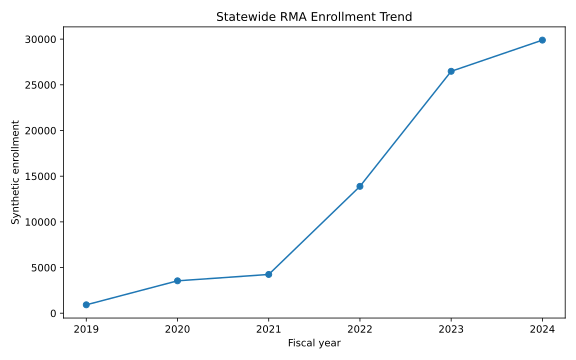

# Texas Refugee Medical Assistance — Longitudinal Geospatial Analysis

A Python longitudinal and geospatial analytics project examining how **synthetic Refugee Medical Assistance enrollment patterns changed across Texas from FY2019 through FY2024**.

Rather than treating the map as a static dashboard, this project centers **time as the primary analytical dimension**: statewide growth, geographic expansion, city trajectories, ZIP persistence, and changing country-of-origin composition.

[**View the live interactive map**](https://fernandoverdugo.github.io/texas-rma-longitudinal-geospatial-analysis/) · [**View project summary**](data/processed/project_summary.json)



> **Portfolio dataset:** All program values are synthetic and intentionally perturbed. The project demonstrates analytical methods and software workflow rather than reporting operational results.

## Why this project

The analysis asks five practical questions:

- How did statewide enrollment change across six fiscal years?
- Where did enrollment expand geographically over time?
- Which cities and ZIP codes became persistent or emerging program areas?
- How did country-of-origin composition change across the period?
- How concentrated or diversified was enrollment in each year?

## Key findings

These findings describe the **synthetic portfolio dataset**:

- Statewide enrollment increases from **921 in FY2019** to **29,892 in FY2024**, an increase of approximately **3,146%** across the six-year period.
- Geographic coverage expands from **196 active ZIP codes / 32 counties** to **695 ZIP codes / 101 counties**.
- **Houston** is the largest FY2024 city in the synthetic dataset with **12,754** enrollments.
- **Cuba** is the largest FY2024 country-of-origin group, accounting for approximately **86.5%** of statewide enrollment; the concentration analysis makes this dominance explicit rather than treating raw counts alone as the story.

## Portfolio highlights

- Complete **695-ZIP × 6-year panel** for FY2019–FY2024
- Long-format ZIP-country-year demographic dataset
- Time-driven interactive Leaflet application with a six-year fiscal-year selector
- Two map modes: **enrollment intensity** and **dominant country of origin**
- Fixed enrollment bins so colors remain directly comparable across years
- Dynamic statewide summary and city/country rankings
- ZIP search, accessible year/ranking controls, hover snapshots, and persistent click/tap details
- Hover tooltips suppressed for zero-enrollment ZIP-years to reduce early-year visual noise
- Viewport-aware tooltips and full selected-year country breakdowns in click detail cards
- Six-year ZIP trend visualization embedded directly in map popups
- Longitudinal exploratory-analysis notebook
- Country concentration analysis using shares and **Herfindahl-Hirschman Index (HHI)**
- ZIP persistence, emergence, and geographic-expansion analysis
- Automated data-quality tests and GitHub Actions CI/CD
- Reproducible pipeline that rebuilds analytical outputs and the deployed application
- Machine-readable project summary tied directly to the source panel and validated in the test suite

## Example analytical use

The synthetic data show statewide enrollment expanding from **921 in FY2019 to 29,892 in FY2024**, while the active geographic footprint grows from **196 ZIP codes / 32 counties to 695 ZIP codes / 101 counties**. A program analyst could use that combination of volume growth and geographic expansion to distinguish two different operational questions: whether demand is simply increasing in existing service areas or whether services may also need to reach new communities.

The city, ZIP-persistence, and country-composition views then help identify where growth is sustained, newly emerging, or highly concentrated. These results are descriptive planning signals only: because the portfolio data are synthetic and aggregate, they do not estimate individual need, eligibility, causation, or future enrollment.

## Skills demonstrated

`Python` · `pandas` · `NumPy` · `Leaflet` · `GeoJSON` · `Matplotlib` · `Jupyter` · `pytest` · `GitHub Actions` · `longitudinal analysis` · `demographic analysis` · `geospatial analytics` · `data validation` · `data visualization`

## Repository structure

```text
.
├── .github/workflows/quality-checks.yml
├── assets/
│   └── statewide_enrollment_trend.svg
├── data/
│   ├── geometry/
│   │   └── rma_zip_geometries_part_*.geojson
│   ├── processed/
│   │   └── project_summary.json    # compact validated review artifact
│   ├── rma_zip_country_year.csv
│   ├── rma_zip_year.csv
│   └── README.md
├── docs/
│   └── index.html                  # generated for GitHub Pages
├── notebooks/
│   └── 01_longitudinal_analysis.ipynb
├── scripts/
│   ├── analyze.py
│   ├── build_map.py
│   └── run_pipeline.py
├── tests/
│   └── test_data_quality.py
├── LICENSE
├── requirements.txt
└── README.md
```

## Analytical workflow

```text
Synthetic ZIP-year + country-year data
                 ↓
          data validation
                 ↓
       longitudinal analysis
        ↙        ↓         ↘
 geographic   demographic   concentration
   change       change        analysis
        ↘        ↓         ↙
        processed outputs
                 ↓
       time-driven Leaflet map
                 ↓
           GitHub Pages
```

## Interactive application

The map is organized around the fiscal-year timeline. Selecting FY2019–FY2024 updates the geographic layer, statewide summary, rankings, tooltips, and legend together.

**Enrollment intensity** uses fixed ranges so the same shade represents the same absolute enrollment range in every year. **Dominant country of origin** colors each active ZIP according to its largest country group for the selected year.

Hover provides a compact selected-year snapshot for ZIPs with enrollment. Clicking or searching a ZIP opens its six-year trend and full selected-year country breakdown, including ZIP-years with no enrollment.

## Exploratory analysis

The [longitudinal analysis notebook](notebooks/01_longitudinal_analysis.ipynb) covers:

- statewide time-series comparisons
- geographic expansion by active ZIP codes and counties
- leading-city trajectories
- country-of-origin composition over time
- HHI and concentration/share analysis
- ZIP persistence and first-active-year analysis
- recent ZIP-level growth and decline
- interpretation limits for small denominators and descriptive aggregate data

## Data validation

The automated test suite verifies:

- expected schema and six-year panel completeness
- unique ZIP-year and ZIP-country-year keys
- active-ZIP footprint by fiscal year
- ZIP totals against country-level detail
- dominant-country calculations
- year-over-year percentage calculations
- cumulative enrollment calculations
- FY2019 baseline comparisons
- geometry/data ZIP alignment
- nonnegative enrollment and complete location labels

## Reproduce the project

The repository targets **Python 3.15** and pins its tested dependency set in `requirements.txt`.

```bash
python3 -m venv .venv
source .venv/bin/activate
python -m pip install --upgrade pip
python -m pip install -r requirements.txt
```

Run the quality checks:

```bash
python -m pytest -q -p no:cacheprovider
```

Rebuild the analytical outputs and interactive map:

```bash
python scripts/run_pipeline.py
```

Open the notebook:

```bash
jupyter lab notebooks/01_longitudinal_analysis.ipynb
```

Preview the map locally:

```bash
python -m http.server 8000 --directory docs
```

Then open `http://localhost:8000`.

## Data

The repository uses aggregate synthetic portfolio data only. No client-level or personally identifiable information is included. See the [data dictionary](data/README.md) for field definitions, synthetic-data treatment, derived outputs, and interpretation notes.

## GitHub Pages

[**Open the live interactive map**](https://fernandoverdugo.github.io/texas-rma-longitudinal-geospatial-analysis/)

GitHub Actions runs the data-quality checks, rebuilds the analysis and interactive application, uploads the generated `docs` directory as a Pages artifact, and deploys it. The generated map HTML does not need to be stored as a large source artifact in Git history.

## License

Code in this repository is available under the [MIT License](LICENSE).
